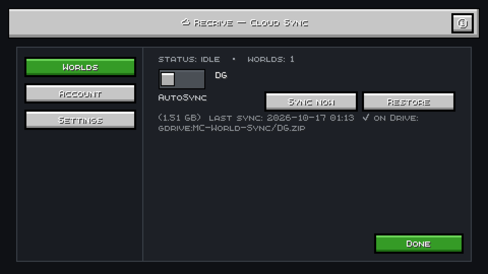
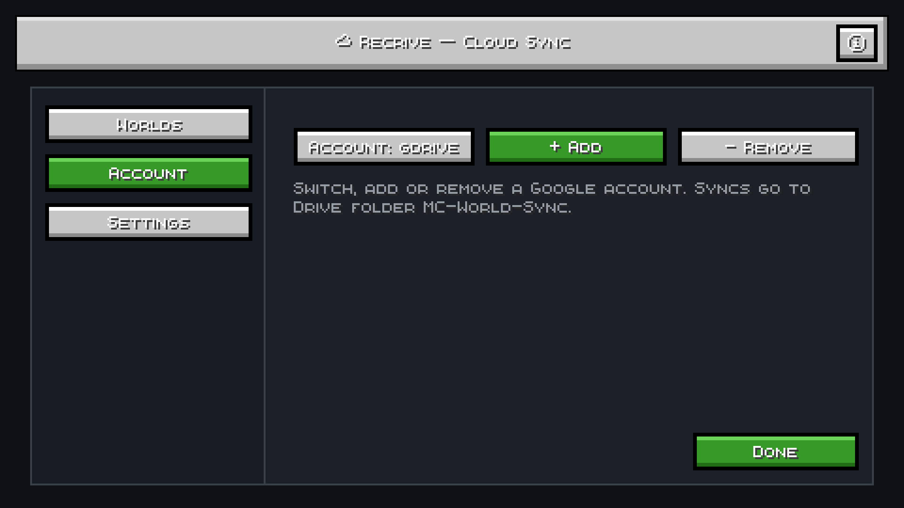
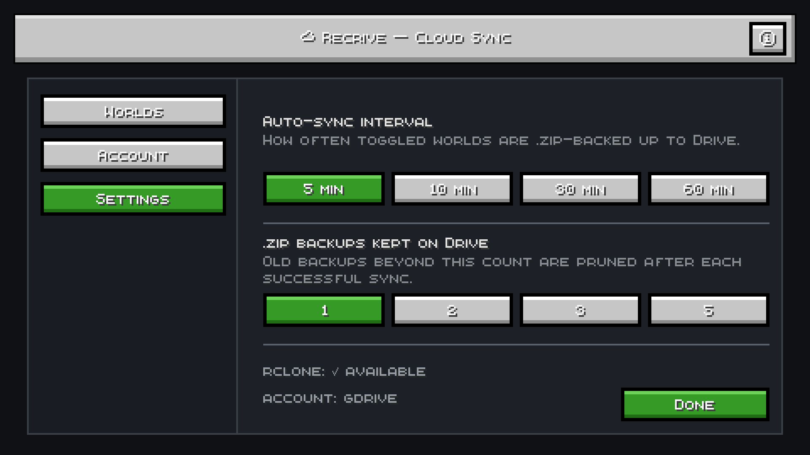

# ☁ Recrive — Cloud synchronization for Minecraft saves

💾 Automatic backup support · 🔄 Sync worlds and player data between devices ·
⚡ Lightweight and easy to use · 🧩 Built for the Fabric mod loader

## Screenshots

**☁ Worlds tab** — AutoSync toggle, Sync Now, Restore, size and last-sync info:



**👤 Account tab** — switch, add or remove Google accounts (rclone remotes):



**⚙ Settings tab** — auto-sync interval, backup retention, rclone status:



## 1. What it does

- Lists **all worlds** in `saves/` with per-world **ON/OFF toggle** —
  ON = automatic `.zip` backup to Drive every N minutes until switched off.
- **Sync is ZIP-only**: the world is packed into one uncompressed `.zip`
  (no CPU recompression — 1.6 GB packs in ~2 s) and that single file uploads
  at full line rate with zero per-file Drive overhead.
- **Sync now** per world; **Restore** per world (downloads the `.zip`,
  local timestamped `.bak` first, then unpacks).
- **Progress is shown only in the pause menu** (top-right cards) and inside
  the ☁ Cloud Sync screen — never over live gameplay.
- **Player data**: `players/`, `stats/`, `advancements/` live inside the world
  folder, so the `.zip` carries worlds + player data together.
- **Multi-account**: account switcher cycles every `rclone` remote — log in
  with any Google account via the in-game Connect button (browser OAuth),
  repeat for more.
- Entry points: slim **☁ Sync** button (title screen top-right + pause menu),
  hotkey (Controls → Recrive, unbound by default), `/recrive` command.

Backend is the `rclone` binary (`~/bin/rclone` or PATH) — no Google Cloud
project, no API keys. Drive layout: `MC-World-Sync/<world>.zip`.
`session.lock` is always excluded; open worlds are skipped, never half-copied.

## 2. Requirements

- Java 21, Fabric Loader ≥ 0.16, Fabric API, `rclone` + at least one
  `rclone config` Drive remote (any Google account).

## 3. Build (verified working on this machine)

```bash
cd ~/recrive
export JAVA_HOME=~/jdk25   # 26.x needs JVM 25+ to run Gradle
~/gradle-dist/gradle-9.8.0/bin/gradle build
# jar → build/libs/recrive-1.1.0.jar  (43 KB — lightweight, no bundled deps)
```

The 1.1.0 jar is already installed in your 26.3 Fabric instance
(`~/.sklauncher/instances/fabric/mods/`). Restart the game to load it.
Needs Fabric API there too (0.162.0+26.3 ✓ present).

## 4. Install rclone (one-time setup)

rclone is the only dependency for Google Drive access. No API keys, no Google Cloud project.

### Windows

1. Download `rclone-v*-windows-amd64.zip` from [rclone.org/downloads](https://rclone.org/downloads/)
2. Extract it to `C:\rclone\`
3. Add `C:\rclone` to your **PATH**:
   - Press Win → search "Environment Variables" → "Edit the system environment variables"
   - Click **Environment Variables** → under "System variables" find `Path` → **Edit** → **New** → paste `C:\rclone`
   - Click OK on all windows
4. Verify: open a new Command Prompt and run `rclone version`

### macOS

```bash
brew install rclone
# or without Homebrew:
curl -O https://downloads.rclone.org/rclone-current-osx-amd64.zip && unzip rclone-current-osx-amd64.zip && sudo cp rclone-current-osx-amd64/rclone /usr/local/bin/
```

### Linux

```bash
# Debian / Ubuntu
sudo apt install rclone
# or universal installer
curl https://rclone.org/install.sh | sudo bash
```

### Verify

```bash
rclone version
```

## 5. Connect a Google account

```bash
rclone config
# n (new) → name: gdrive → storage: drive → scope 1 → auto config Yes
# → browser → log in with ANY Google account → Allow
```

Then open ☁ Sync → ☁ Recrive screen → click **Account:** until it shows your remote.

## 6. Safe-use rules

- Close a world before **Sync now** / **Restore** on it (open worlds are
  auto-skipped by the daemon, but manual buttons assume you closed it).
- First upload of a big world takes a while; later runs are incremental (`--update`).
- Restore never deletes local data without a `.bak-timestamp` copy.

## 7. Version note

This tree targets **MC 26.3 / loader 0.19.5 / fabric-api 0.162.0+26.3** with
the new non-remap Loom (`net.fabricmc.fabric-loom`, split source sets, code
in `src/client/java`). Since 26.1 the game is unobfuscated, so code uses
Mojang names directly (no yarn/intermediary): `GuiGraphicsExtractor`,
`PauseScreen`, `setScreenAndShow`, `KeyMappingHelper`,
`InputConstants.Type.KEYBOARD`, SDL instead of GLFW. The old
1.21.11/yarn tree is backed up at `~/recrive-1.21.11-backup`.

## 8. Speed (why uploads were slow, what changed)

Diagnosis on DG (1.62 GB, 1625 files, median 15 KB): 80% of files <1 MB. Every
file costs several Drive API round-trips, so per-file syncing starved even a
good link — the link was never the bottleneck.

Fix: sync is now **ZIP-only**. The world packs into one `.zip` with zero
recompression (measured 1.62 GB in ~2 s) and that single file uploads with
128M chunks at full line rate. The uploaded `.zip` is verified by remote-size
check afterwards. (The `~/sk-world-sync/sk-sync` CLI still offers both folder
`sync` and `.zip` `turbo` commands.)

## 9. Backup retention (auto-cleanup)

Drive side never piles up (folder sync overwrites in place, Turbo uses one
fixed `<world>.zip`), but every Restore leaves a local `<world>.bak-*` safety
copy in `saves/`. After every **successful** sync/turbo (auto or manual) the
mod deletes old `.bak-*` folders for that world, keeping the newest
`bakKeep` (default 1; set `0` in `config/recrive.json` to keep none).
Cleanup runs only on success — a failed upload never costs you a backup —
and prefix-matching (`<world>.bak-`) means the live world and other worlds
are never touched. The CLI does the same (keeps 1).
